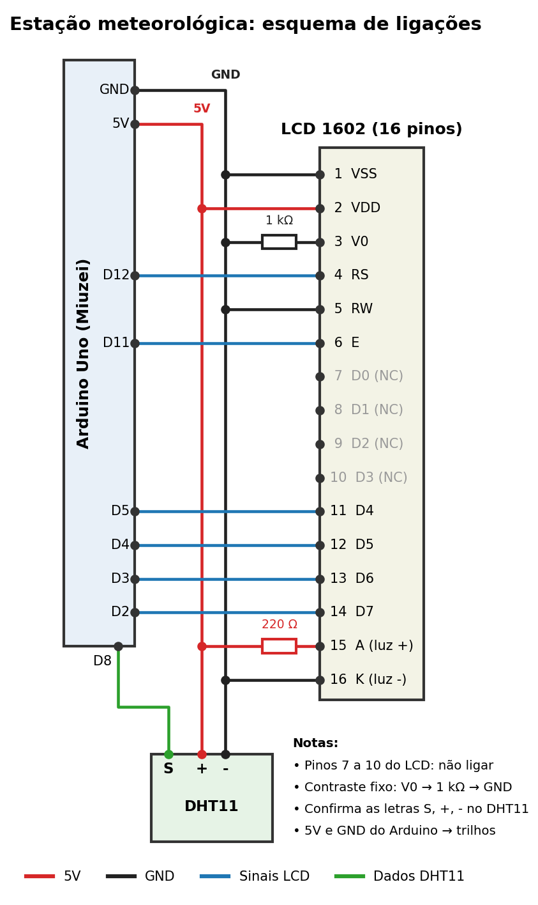
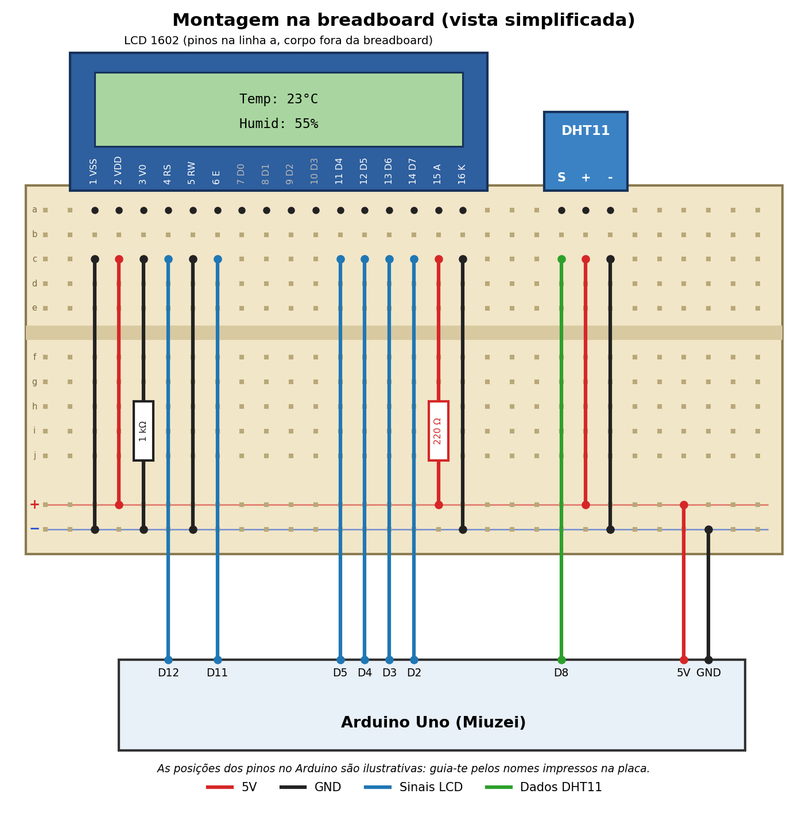

# Estação Meteorológica com Arduino

Projeto de hobby que mede a **temperatura** e a **humidade** com um sensor DHT11 e mostra os valores num ecrã LCD 16x2. Os valores são também enviados pela porta série (USB) no formato `temperatura,humidade`, para poderem ser registados no PC.

<!-- Quando tiveres uma foto da montagem a funcionar, guarda-a em docs/foto.jpg e descomenta a linha abaixo -->
<!--  -->

## Componentes

- Arduino Uno R3 (placa compatível, kit Miuzei)
- Módulo sensor de temperatura e humidade DHT11 (3 pinos)
- Ecrã LCD 1602 (16x2), versão paralela de 16 pinos
- Breadboard
- Resistência de 1 kΩ (contraste do LCD)
- Resistência de 220 Ω (luz de fundo do LCD)
- Fios jumper
- Cabo USB

## Esquemas

## Ligações

### LCD 1602

| Pino LCD | Nome | Liga a |
|---|---|---|
| 1 | VSS | GND |
| 2 | VDD | 5V |
| 3 | V0 | GND, através de resistência de 1 kΩ |
| 4 | RS | D12 |
| 5 | RW | GND |
| 6 | E | D11 |
| 7 a 10 | D0 a D3 | não ligados |
| 11 | D4 | D5 |
| 12 | D5 | D4 |
| 13 | D6 | D3 |
| 14 | D7 | D2 |
| 15 | A (luz de fundo +) | 5V, através de resistência de 220 Ω |
| 16 | K (luz de fundo -) | GND |

### Sensor DHT11

| Pino do módulo | Liga a |
|---|---|
| `-` (GND) | GND |
| `+` (VCC) | 5V |
| `S` (dados) | D8 |

> A ordem dos pinos pode variar entre módulos. Confirma as letras impressas na placa antes de ligar.

O 5V e o GND do Arduino ligam-se aos trilhos da breadboard, e os restantes componentes ligam-se a esses trilhos.

## Como usar

1. Monta o circuito de acordo com os esquemas.
2. Abre `arduino-weather-station.ino` no Arduino IDE.
3. Instala as bibliotecas em *Tools → Manage Libraries*:
   - **DHT sensor library** (Adafruit)
   - **Adafruit Unified Sensor** (dependência da anterior)
   - A `LiquidCrystal` já vem com o IDE.
4. Em *Tools → Board*, escolhe **Arduino Uno** e seleciona a porta correta.
5. Carrega o código com **Upload**.

No LCD aparecem a temperatura e a humidade, atualizadas de 2 em 2 segundos. No *Serial Monitor* (9600 baud) aparecem linhas como `23.00,55.00`.

## Resolução de problemas

- **LCD com luz mas sem texto, ou só com quadrados:** o contraste pode estar mal ajustado (experimenta outro valor de resistência no pino 3, ou usa um potenciómetro) ou há fios de sinal trocados.
- **LCD sem luz:** verifica os pinos 15 e 16 e a alimentação dos trilhos.
- **"Erro no sensor" no LCD:** confirma o fio de dados no D8 e a alimentação do DHT11.
- **`DHT.h: No such file or directory`:** falta instalar a biblioteca do DHT.

## Próximos passos

- Script em Python para registar os dados num ficheiro CSV e gerar gráficos
- Versão com ESP32 para enviar os dados por WiFi para um dashboard

## Autor

Gustavo Couto — [github.com/guga1337](https://github.com/guga1337)
